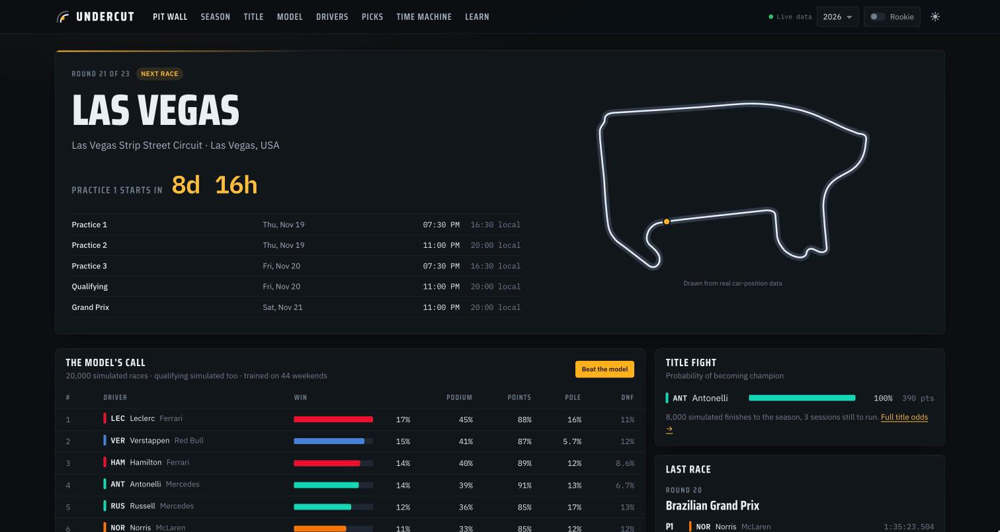
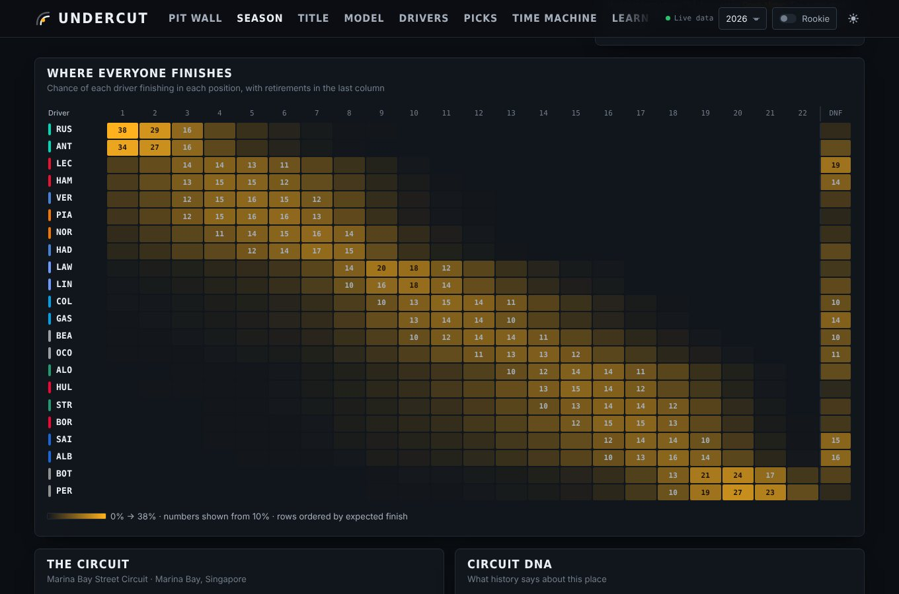
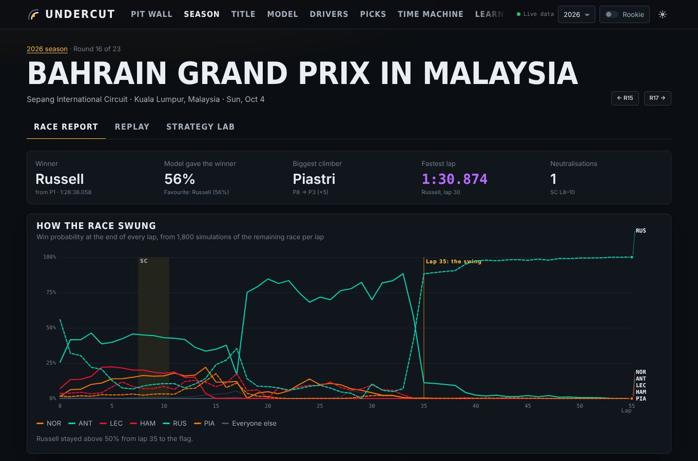
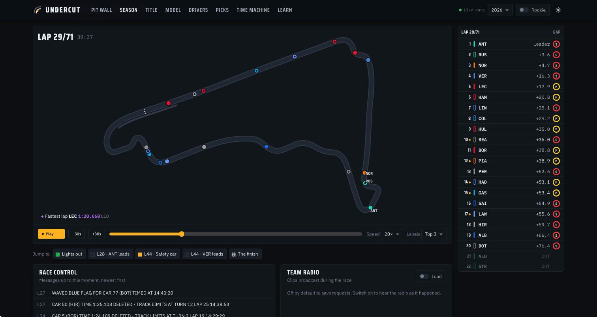
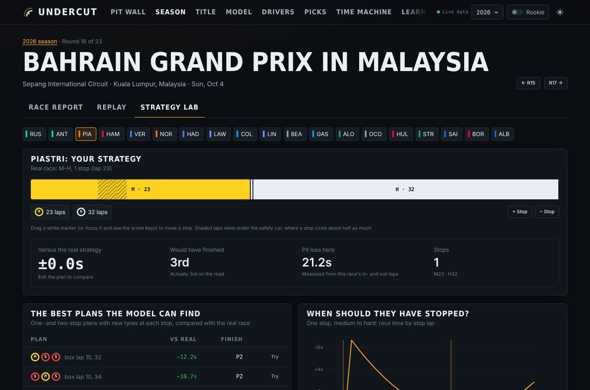
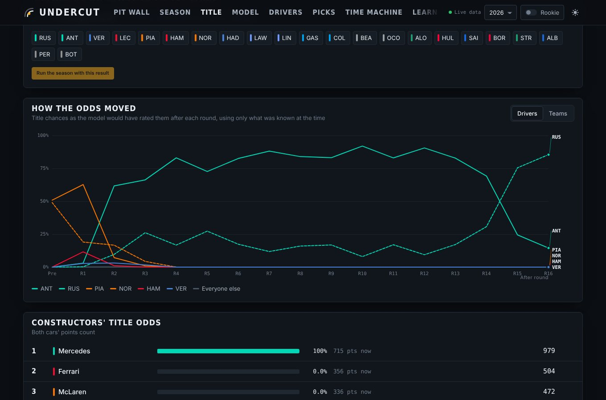
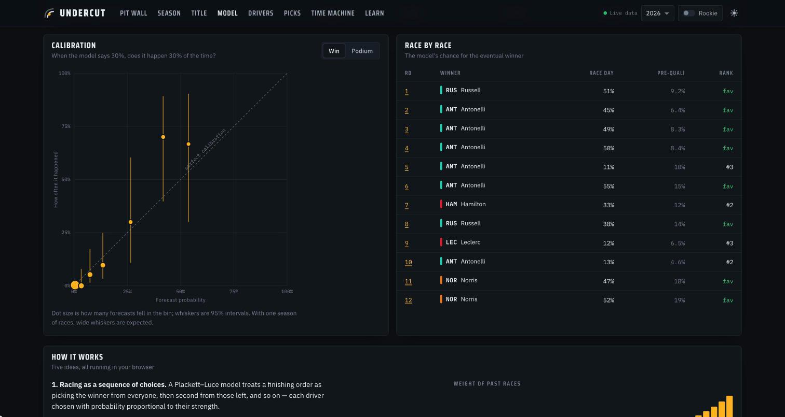

# Undercut

Undercut is a Formula 1 site that predicts every race and the championship, then checks how those predictions actually turned out. You can also replay any race lap by lap on the real track, or change a driver's pit stops and see where they would have finished.

**Live site: [aditya-gupta2307.github.io/undercut](https://aditya-gupta2307.github.io/undercut/)** (works on desktop and phone)

## What's on the site

| Page | What it does |
| --- | --- |
| Pit Wall | Countdown to the next session, the model's pick for the next race, title odds and a recap of the last race. |
| Race preview | Win, podium and points chances for every driver, a heatmap of where each driver is likely to finish, qualifying results, the race-day rain forecast and the circuit's history. |
| Race report | A chart of every driver's chance of winning after each lap, plus the gaps, positions, tyre strategies, pit stops and race control messages. |
| Replay | The whole race on the real circuit at up to 50x speed, with a timing tower, tyres, safety car periods, race control and team radio. |
| Strategy Lab | Drag a driver's pit stops or change their tyres to see the time gained or lost and where they would have finished. It also searches every one- and two-stop plan for the fastest one. |
| Title | Championship odds, who can still win it, a what-if tool and how the odds changed after every round. |
| Model Lab | How the model works and how accurate it has been this season, with settings you can play with. |
| Drivers | Ratings that separate the driver from the car, and teammate head-to-heads. |
| Picks | Call the podium before the race and try to beat the model. |
| Time Machine | This season's results scored with the points systems of older eras. |
| Learn | A short guide to F1 for new fans. Rookie mode explains F1 terms anywhere on the site. |

| Race preview | Race report |
| --- | --- |
|  |  |
| **Replay** | **Strategy Lab** |
|  |  |
| **Title odds over the season** | **Model Lab** |
|  |  |

## How the predictions work

Every driver gets a rating made of two parts, one for the car and one for the driver. Teammates share the car part, so the driver part shows how someone compares with their teammate in the same car. The ratings come from a ranking model (Plackett-Luce) fitted to this season's results, where recent races count more and last season counts a bit. A separate model estimates how likely each car is to break down or crash out.

The site then simulates the next race 20,000 times and the rest of the season 8,000 times, and the percentages are just how often each outcome came up. During a race the same thing happens after every lap using the real gaps, tyres and pit stops, which is where the lap-by-lap win chart comes from.

The Model Lab page goes back through the season and predicts each race using only what was known before it, then compares those predictions with what happened and with simple guesses like the grid order. The model doesn't know about weather, upgrades or late penalties, so wet races are harder to call than the numbers suggest.

## Where the data comes from

Results and standings come from the [Jolpica F1 API](https://github.com/jolpica/jolpica-f1). Lap times, pit stops, car positions and team radio come from [OpenF1](https://openf1.org), and rain forecasts from [Open-Meteo](https://open-meteo.com). There's no server behind the site. Your browser downloads the data and does all the maths itself. Race pages fill in shortly after each session ends, and you can switch back to earlier seasons too.

Built with React, TypeScript and d3.

---

Undercut is an unofficial fan project and isn't associated with the Formula 1 companies. F1, FORMULA ONE, FORMULA 1, FIA FORMULA ONE WORLD CHAMPIONSHIP, GRAND PRIX and related marks are trade marks of Formula One Licensing B.V. Team radio audio belongs to Formula 1.
